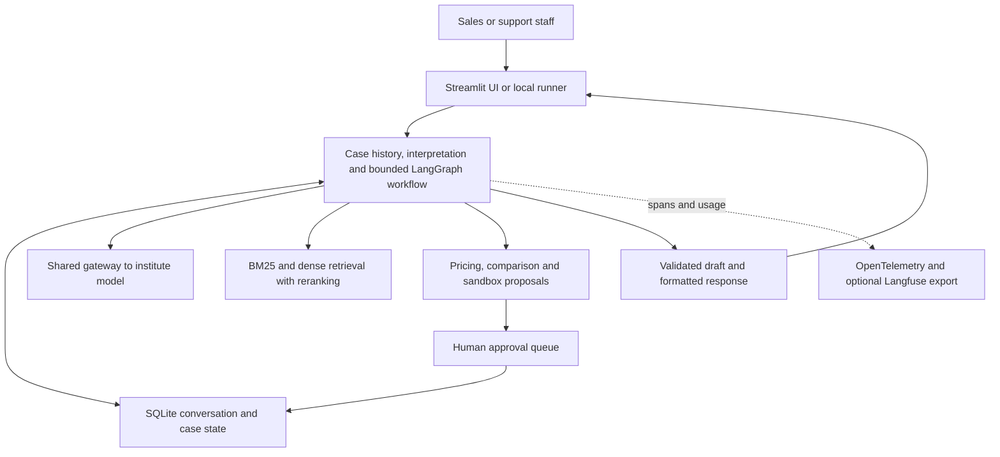

# Location Enquiry Assistant

A sales and support copilot for **Directions, Distance Matrix, Autocomplete and Reverse Geocode** enquiries. Built for the institute's Track B capstone, it compares plain-model prompting with a bounded agentic workflow using the institute-provided model endpoint.

**Start here:** the [project specification](docs/project-specification.md) explains the problem, goal, scope, solution, architecture, modules, enquiry flow, measured results and remaining work.

## Problem and goal

Sales and support staff must interpret enquiries, search documentation, remember earlier conversations, compare providers and decide who should act next. Manual handling can produce slow replies, inconsistent guidance, incomplete qualification and repeated diagnostic questions.

The goal is to help staff prepare faster, grounded responses with fair comparisons and clear ownership. This is a controlled capstone prototype. It prepares drafts and sandbox proposals; it does not send customer messages, update production records or perform real ticket handoffs.

## What the assistant does

- Identifies intent, API and team, extracts customer requirements and records missing information.
- Retrieves supporting documentation and cites the passages used in a response.
- Compares documented pricing, capabilities, coverage and limits using equivalent requirements and explicit assumptions.
- Restores case history and supplied facts when handling a follow-up or reopening a case.
- Returns an owner and next action, including a provisional owner when customer status is unknown.
- Holds sandbox updates and escalations for human review, with decisions and applied diffs recorded in an audit log.

The customer-facing reply uses **Answer**, **Key details**, **Assumptions / missing information**, **Next step** and **Sources**, omitting empty sections. Staff can inspect structured outputs and traces separately.

Dedicated multilingual or multimodal benchmarking, other map APIs, exhaustive provider coverage, route optimization and production operations are outside scope. See the [full scope and exclusions](docs/project-specification.md#4-scope).

## How it works



Rules extract explicit facts before model interpretation. Deterministic checks validate the model's output, preserve evidence and calculate missing fields. LangGraph coordinates retrieval, tools, drafting and critic review within **10 steps**. The shared gateway enforces context, retry and enquiry limits; pricing arithmetic runs in code.

The main technologies are Python 3.12, LangGraph, Pydantic, JSON Schema, Streamlit, SQLite, BM25, ChromaDB, reciprocal rank fusion, BGE embeddings/reranking, OpenTelemetry and Langfuse. The app does not call map-provider APIs to probe live service behavior.

## Evaluation results

The final campaign compared the selected self-consistency prompting baseline with the agent on the same **80 frozen cases** and **96 eligible holdout cases**.

| Metric | Frozen baseline | Frozen agent | Holdout baseline | Holdout agent |
|---|---:|---:|---:|---:|
| Automatic rubric answer accuracy | 39.15% | 69.20% | 40.43% | 60.80% |
| Comparison completeness | 9.50% | 34.04% | 2.33% | 25.12% |
| Strict qualification completeness | 47.92% | 90.69% | 37.04% | 91.32% |
| Owner correctness | 26.25% | 90.00% | 33.33% | 73.96% |
| Prediction schema validity | 100.00% | 100.00% | 100.00% | 100.00% |
| Mean generation latency, ms | 27,118.92 | 11,632.63 | 26,453.28 | 9,429.75 |

These are controlled evaluation results, not production SLAs or independent human ratings. The agent produced drafts for 70/80 frozen and 79/96 holdout cases. Citation coverage among those drafts was 95.71% and 98.73%, with precision of 96.68% and 98.92%. Strong citations do not establish complete answers.

Holdout authorization remains provisional. Seven flagged holdout records were excluded, one AC-050 baseline citation judgement was explicitly adjudicated, and one frozen generation has incomplete usage. Institute endpoint access is free; monetary figures in reports are illustrative estimates. The [final report](results/evaluation/README.md) retains all metrics, denominators, limitations and audit links.

## Quick start

Use **Python 3.12** and a writable checkout. Clean installation was verified on macOS ARM64; Linux has not been independently verified. Native Windows is not supported by the current POSIX file-lock implementation. Run these commands from the repository root.

### 1. Install the application

```bash
python3.12 -m venv .venv
source .venv/bin/activate
python -m pip install --upgrade pip
python -m pip install -e .
python -m pip check
```

This installs the BM25 application. After activation, `python` and `python3` refer to the environment; either works in the following commands.

### 2. Configure chat access

You need the institute-issued chat API key and its CA certificate. In the terminal used to start the app:

```bash
printf 'Chat API key: '
read -r -s TRACKB_API_KEY
printf '\n'
export TRACKB_API_KEY
export TRACKB_CA_CERT='/absolute/path/to/chat-ca.crt'
export HF_HOME="$PWD/.model-cache"
```

Replace the certificate path with your readable file. Keys and certificates stay outside Git. A `.env` file alone does not configure the chat client. Review `copilot/config/approvers.yaml` before testing approvals; its local reviewer selector does not authenticate identities for a shared host.

### 3. Prepare, check and launch

```bash
python -m copilot.deployment.prepare --mode bm25
python -m copilot.deployment.check --mode bm25 --live --report /tmp/copilot-setup-check.json
python -m streamlit run copilot/streamlit_ui/streamlit_app.py --server.address 127.0.0.1 --server.port 8501 --server.headless true --browser.gatherUsageStats false
```

Preparation downloads the required pinned assets. The `--live` check sends synthetic requests to verify model access. Resolve failed checks before submitting enquiries.

Open **http://127.0.0.1:8501**, select **BM25**, and try “What coordinate order does Mapbox Directions use?” For “How do I set waypoints in the Directions API?”, answer the provider clarification in the same case. Reopen it to inspect the conversation, review proposals in **Approvals**, and inspect workflow details in **Traces**.

For **Hybrid + reranking (one passage per URL)**, follow the [deployment guide](docs/deployment.md): install `.[retrieval]`, configure embedding access and its certificate, prepare hybrid assets and rebuild the dense index. Select hybrid only after its prerequisites pass. The bundled corpus contains 509 documents at a 480-token target chunk budget; its source-scope limitations are listed below.

For development tests, install `requirements.txt` and run `python -m pytest -q`. The existing freshness integration check requires a dated raw-source snapshot and skips when it is absent. Preserve the case database during updates; runtime databases, credentials, model caches and rebuildable indexes remain outside Git.

## Current status and remaining work

The integrated enquiry UI, conversation storage, tools, sandbox approvals, bounded orchestration, reliability controls, tracing, final paired evaluation and saved-report dashboard are implemented. Passing execution checks does not mean every answer-quality target is met.

- **Clarifying questions:** Activity 14 F1 is 55.83% on the latest full working-eval run and 28.57% on the updated frozen run, below the 80% target.
- **Answer completeness and retrieval:** comparison completeness and strict span recall need improvement. Holdout ownership is also below the frozen acceptance result. New experiments belong on grouped working-eval, not frozen or holdout data.
- **Gold review:** provisional holdout authorization does not replace independent review. Annotation and reference-policy disagreements remain documented.
- **Corpus and coverage evidence:** despite the agreed HERE exclusion, the locked corpus and source manifest contain nine HERE documents. The [project specification](docs/project-specification.md#17-remaining-work-and-limits) records the discrepancy without changing historical scores. Mapbox standard-driving coverage for India remains unverified in the comparison evidence.
- **Public rollout:** HTTPS and migration support are implemented. Real DNS/TLS, login, media access and full destination-stack restore/persistence still need target-host verification.

## Repository layout

| Path | Purpose |
|---|---|
| `copilot/enquiry_interpretation/` | Interpret enquiries and extract qualification details. |
| `copilot/model_gateway/` | Hosted model client and endpoint contract checks. |
| `copilot/enquiry_workflow/` | LangGraph routing, case turns, and workflow adapters. |
| `copilot/registered_tools/` | Tool execution and Pydantic contracts. |
| `copilot/conversation_state/` | Case-scoped conversation state model. |
| `copilot/rag/` | Document ingestion, indexing, hybrid retrieval, reranking, and the local corpus. |
| `copilot/response_drafting/`, `copilot/pricing_tools/` | Structure responses and calculate sourced pricing. |
| `copilot/case_storage/` | SQLite persistence for cases, approvals, sandbox records, and traces. |
| `copilot/streamlit_ui/` | Staff interface for enquiries, approvals, and traces. |
| `copilot/evaluation/` | Paired baseline/agent evaluation, independent retrieval diagnostics and protected holdout execution. |
| `copilot/metrics_dashboard/` | Read-only metric comparisons, saved activity-report browsing and filtered publication bundles. |
| `copilot/observability/` | End-to-end OpenTelemetry tracing, local Langfuse export and INR cost reporting. |
| `copilot/deployment/` | Prepare model assets and check installation, configuration and live access. |
| `results/clean-deployment/` | Clean-checkout installation, index rebuild and end-to-end verification evidence. |
| `copilot/enquiry_workflow/verification/` | Synthetic UI and frozen workflow verification scripts. |
| `copilot/enquiry_workflow/results/` | Saved workflow verification results. |
| `copilot/validation/specification_checks/` | Standalone C1 checker, guide, and saved report. |
| `contracts/`, `schemas/`, `vocab/` | Input/output contracts and controlled labels. |
| `data/ground-truth.xlsx` | Updated project GT workbook. |
| `data/` | GT review records and Activity 3–5 supporting artifacts. |
| `copilot/enquiry_interpretation/results/` | Activity 2's 80-record inputs, gold, predictions, per-record results, scores and manifest. |
| `eval/frozen-interpretation/` | Versioned frozen Activity 2 snapshot. |
| `eval/activity-3-pilot/` | Ten-case annotation pilot, templates, examples and two-annotator agreement results. All three κ targets pass; disagreement adjudication remains pending. |
| `copilot/model_gateway/results/` | Synthetic endpoint checks and the 80-case endpoint reliability/latency run. |
| `docs/`, `tests/` | Component documentation and automated tests. |

## Component guides

- [Project specification](docs/project-specification.md)
- [Installation and deployment](docs/deployment.md)
- [Interpretation design](docs/activity-2-interpretation-design.md)
- [Interpretation results](copilot/enquiry_interpretation/results/report.md)
- [Gold annotation guide](docs/activity-3-labeling-guide.md)
- [Gold record contract](docs/activity-3-gold-record.md)
- [Workflow setup and verification](copilot/enquiry_workflow/README.md)
- [Model gateway](docs/model-gateway.md)
- [Model gateway run summary](copilot/model_gateway/results/frozen-001/summary.md)
- [Ownership routing](docs/ownership-routing.md)
- [Workflow review and clarification gaps](docs/enquiry-workflow-review.md)
- [Reliability controls](docs/activity-20-reliability.md)
- [End-to-end tracing setup](copilot/observability/README.md)
- [Public Langfuse and reports](copilot/observability/langfuse/PUBLIC_DEPLOYMENT.md)
- [Historical trace migration](copilot/observability/langfuse/HISTORICAL_MIGRATION.md)
- [Final evaluation report](results/evaluation/README.md)
- [Evaluation harness](copilot/evaluation/README.md)
- [Metrics dashboard](copilot/metrics_dashboard/README.md)

The current workbook is `data/ground-truth.xlsx`: 532 records, including 80 frozen cases. The active working-eval subset has 317 cases. Historical manifests retain their original hashes and source locations, including references to data outside Git at the time. Model-gateway endpoint checks measure completion reliability and latency, separately from interpretation and answer quality.

[Historical C1 README](docs/legacy-c1-readme.md) preserves the original task-specification documentation. It describes an earlier workspace layout.

## Prompt-engineering baseline

The isolated [prompt comparison module](prompt-engineering-baseline/README.md) retains three prompting strategies, a shared-model-client adapter and an optional standalone demo with a separate setup. It is distinct from the final evaluation harness and its selected baseline.
