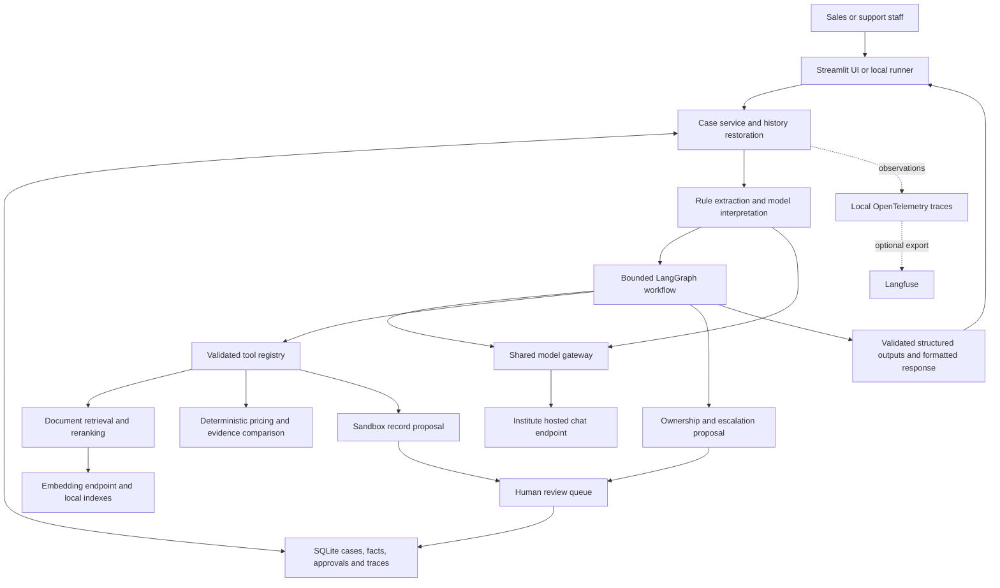

# Location Enquiry Assistant project specification

Updated 26 November 2026.

Location Enquiry Assistant is a sales and support copilot for location API enquiries. It helps staff understand a request, retrieve supporting documentation, compare providers, prepare a reply and decide who should act next. Record changes and escalations are demonstrated in a sandbox with human approval.

The capstone compares a plain-model prompting baseline with an agentic workflow using the institute's hosted model. The final evaluation shows better answer accuracy, grounding and task handling with the agent, while clarification quality, comparison completeness and some retrieval and ownership results still need improvement. It is a controlled prototype, not a production customer-service system.

This document describes the current project as a whole. The earlier [task specification](../spec/spec.md) remains the historical source for output contracts and acceptance definitions. Its old data paths, provider list and implementation-stage notes should be read in that context. Current runtime behavior, data membership and measured results are described below and linked to their component guides.

## 1. Problem statement

Sales and support teams manually interpret location-based enquiries, consult documentation and conversation history, draft responses, update records and compare providers on pricing, capabilities, coverage and limits. This work can lead to slow responses, inconsistent advice, incomplete qualification, repeated diagnostic questions and unclear responsibility for the next action.

A provider name, API name or price is not enough to resolve an enquiry. The answer can depend on region, workload units, product version, account eligibility, technical requirements and facts supplied in earlier turns. Missing or unsupported information needs to remain visible rather than being filled in by the model.

## 2. Goal and intended impact

The goal is to help staff respond faster with consistent, accurate guidance and fair provider comparisons. Each enquiry should have a useful response or clarification, the relevant qualification details, an accountable role and a clear next action.

The project tests whether retrieval, deterministic tools, conversation state and bounded orchestration improve on plain-model prompting. It measures latency and illustrative cost alongside quality. It does not directly measure staff productivity, production response times or real-world map accuracy.

## 3. Users and main use cases

| User or situation | What the assistant should help with |
|---|---|
| Sales staff qualifying a prospect | Capture requirements, identify missing decisions and assess documented product fit. |
| Staff preparing a quote or comparison | Compare public prices on the same API, geography and workload, with units and assumptions stated. |
| Support staff answering an integration question | Explain documented parameters, behavior and restrictions with source references. |
| Support staff investigating a failure | Reuse symptoms and checks already supplied, ask for material missing evidence and recommend escalation where needed. |
| Staff returning to an existing case | Restore the conversation, known facts, pending question and proposal history. |
| Reviewer handling a proposed action | Inspect, edit, approve or reject a sandbox update or escalation, with an audit trail. |

Staff use the Streamlit interface or the local enquiry runner. Customer-facing replies remain drafts; the application does not send them externally.

## 4. Scope

### In scope

- Sales and support enquiries about **Directions, Distance Matrix, Autocomplete and Reverse Geocode**.
- Interpretation, qualification, documentation guidance, integration and troubleshooting, history-aware follow-ups, proposed record updates, ownership and next actions.
- Retrieval of documentation and use of case history to ground answers and avoid repeating supplied or declined questions.
- Comparisons of documented pricing, capabilities, geographic coverage and limits using equivalent requirements and explicit assumptions.
- A plain-model baseline and a bounded agentic workflow, tested in a controlled environment.
- Separate measurement of retrieval quality, answer quality, qualification, history use, ownership, next actions and tool execution, with latency and cost logging.
- Sandbox demonstrations of review and action application, plus local tracing, saved reports and optional public HTTPS hosting for Langfuse and reports.

| API | Enquiries covered |
|---|---|
| Directions | Routes between locations, travel time, distance, travel modes and documented route parameters. |
| Distance Matrix | Travel times and distances across origin-destination pairs, with matrix size and element billing kept distinct. |
| Autocomplete | Suggestions while a user types, including documented request/session behavior and restrictions. |
| Reverse Geocode | Address or location information returned for coordinates, including documented filters, precision fields and limits. |

### Out of scope

- Dedicated multilingual or code-switched benchmarking, voice, images and other multimodal inputs.
- Forward geocoding, Place Details or nearby search as standalone target tasks, map rendering, navigation SDKs, geofencing, and fleet or route optimization. Related products can appear as documented dependencies, such as autocomplete session billing, without becoming additional benchmark APIs.
- Exhaustive provider, geography, product or contract coverage, or claims about undocumented capabilities.
- Unlimited dialogue depth, unrestricted branching conversations or memory shared across unrelated cases and sessions. Case history is persisted and restored for the same case.
- Production record writes, real ticket handoffs, external messages, autonomous follow-ups and production SLAs.
- A dedicated adversarial/security benchmark or direct measurement of map accuracy and geographic service quality.
- Treating unresolved labels or unvalidated records as independently confirmed gold.

### Providers and source boundaries

The original GT and comparison vocabulary cover Google Maps Platform, Ola Maps, Mapbox, Mappls (MapmyIndia), OSM Nominatim and OSRM. Nominatim and OSRM are separate services. The expanded retrieval corpus also contains documentation for Amazon Location Service, Azure Maps, Esri ArcGIS, TomTom and Geoapify. A provider's presence in retrieval does not mean every product is supported by the pricing calculator or comparison contract.

The agreed corpus policy excludes HERE. A review for this document found that the current source manifest and locked processed corpus still contain **nine HERE documents and 50 chunks**. This is an open scope discrepancy. The locked sources and existing scores have been preserved; correcting the corpus requires a separately versioned change, index rebuild and verification. The corpus also contains selected community material and supporting FX references, so it should not be described as entirely official provider documentation. Prefer official evidence for product and policy claims.

## 5. Proposed solution

The assistant combines rules, a hosted language model, retrieval and application controls. The model helps interpret language and choose or assess evidence. Code validates the result, performs arithmetic, manages state and enforces action limits.

| Problem | Solution approach |
|---|---|
| Ambiguous or incomplete requests | Extract explicit facts, classify the task and ask only for information needed for the decision. |
| Unsupported answers | Retrieve source passages, attach citations and check grounding and relevance before accepting a draft. |
| Unfair or inconsistent comparisons | Normalize workload and billing units, use the same requirements and state missing evidence. |
| Repeated questions | Save facts, evidence, asked questions and deferrals with the case and reuse them in follow-ups. |
| Unclear responsibility | Return an owner, escalation decision, reason and next action, including provisional ownership where status is unknown. |
| Uncontrolled actions | Validate registered tool inputs and outputs and hold consequential proposals for human approval. |
| Difficult debugging | Record workflow spans, tool calls, latency, token usage and separate retrieval diagnostics. |

## 6. High-level design

The application uses a modular Python package. LangGraph controls the workflow; planner, executor and critic are application responsibilities using the shared model client, not separately trained models.

The evaluation harness runs alongside the application. It passes the same enquiry and history to the baseline and agent, then scores their saved outputs. Reference answers and expected labels are available to scoring, not response generation. The metrics dashboard reads completed reports without invoking the model.

## 7. Enquiry flow

1. **Receive and validate the enquiry.** Select a new or existing customer case. Reject an empty input and redact sensitive values where supported.
2. **Restore case context.** Load chronological history, confirmed facts, diagnostic state and pending clarification. A reply to a pending question is bound to its original task; it does not become an unrelated enquiry.
3. **Interpret the request.** Rules extract explicit facts and matched evidence. The model receives these as hints and proposes intent, API, team and qualification. Deterministic post-checks validate labels, grounding and missing fields; repair and fallback are bounded.
4. **Choose a route.** The workflow may answer, ask a necessary clarification, produce qualification advice, compare providers, propose an update or recommend escalation. Provider questions depend on whether a specific provider is needed to answer the task.
5. **Gather evidence and calculate.** Registered tools search documentation, calculate or compare costs, and prepare record proposals. Comparisons use common requirements and flag unsupported dimensions.
6. **Draft and review.** Documentation paths select and cite retrieved passages. Deterministic paths render supported calculations or guidance. The critic checks the applicable schema, evidence binding and relevance, with retries inside the step budget.
7. **Add appropriate follow-up suggestions.** Diagnostic and qualification planners use customer evidence and retrieved context. Suggested staff questions remain distinct from the active customer clarification and pending reply.
8. **Save the result.** Persist structured outputs, the customer-facing response, state changes, proposals and trace identifiers.
9. **Review consequential proposals.** A human can edit, approve or reject a sandbox proposal. Approved sandbox changes and review decisions are recorded; no production system is updated.

The core graph permits at most **10 steps**. Reaching a limit or failing to establish an answer leads to a controlled fallback or escalation, not an unbounded loop. A delivered clarification completes the current turn while leaving the case awaiting input.

## 8. Inputs and outputs

An enquiry supplies the current query and may include prior turns, known facts, a case identifier and a confirmed customer relationship. Confirmed relationship must be supported by customer or account evidence. GT context, reference answers and rubric are not ordinary customer input.

Interpretation separates **intent** (what the customer needs), **API** (the operation involved) and **team** (Sales or Support). The eight scored intents are `pricing_quote`, `pricing_comparison`, `sales_qualification`, `capability_match`, `coverage_limits`, `docs_how_to`, `troubleshooting` and `human_handoff`. An evaluation **bucket** describes the scenario being tested; it is not another name for intent or the final escalation decision.

The structured envelope has seven outputs:

| Output | Contents |
|---|---|
| Response draft | Grounded reply, citations and any refusal or evidence limitation. |
| Clarifying questions | Material missing information, with question details. |
| Qualification details | API/use case, region, workload, current provider, timeline, optional requirements, missing fields and completeness. |
| Proposed record update | Target record, proposed field changes and approval state. |
| Comparison | Equivalent requirements, cost, capabilities, coverage, limits, assumptions and supporting sources where applicable. |
| Responsible role | Owner, team, escalation flag, severity and reason. |
| Next action | Answer, clarify, propose an update, propose escalation or refuse. |

JSON Schema and Pydantic validate the contracts. The case service also creates `customer_response` for presentation, with **Answer**, **Key details**, **Assumptions / missing information**, **Next step** and **Sources**. Empty sections are omitted. Formatting does not change the structured decision or execute an action.

The qualification schema lists required fields even when they are missing. That list is completeness metadata, not an instruction to ask every missing field on every documentation question. Follow-up selection depends on the customer's task and supplied history.

## 9. Modules and responsibilities

Each path below is a separate folder under `copilot/`.

| Module | Responsibility |
|---|---|
| `enquiry_interpretation/` | Rule extraction, model-assisted classification, qualification extraction, validation and fallback. |
| `enquiry_workflow/` | Case processing, LangGraph planning/execution/review, provider resolution, ownership, comparisons and proposal integration. |
| `model_gateway/` | Shared hosted-model client, chat/JSON/tool-call support, token counting, request serialization and reliability controls. |
| `rag/` | Document ingestion, provenance, chunking, BM25/dense indexes, retrieval, fusion and reranking. |
| `pricing_tools/` | Billing-unit normalization, flat/tiered arithmetic and pricing qualification. |
| `registered_tools/` | Registered tool dispatch and Pydantic input/output validation. |
| `conversation_state/` | Typed, case-scoped conversation state. |
| `case_storage/` | SQLite persistence for cases, messages, facts, sandbox records, proposals, decisions and traces. |
| `diagnostics/` | Shared diagnostic facts, evidence, completed checks and diagnostic question selection. |
| `qualification/` | Requirement extraction, applicable decision groups, missing-fact planning and question wording. |
| `response_drafting/` | Follow-up integration and customer-facing response formatting. |
| `safety/` | Customer-evidence and routing guards, redaction and supporting safety checks. |
| `models/` and `validation/` | Generated typed models and shared schema/consistency checks. |
| `streamlit_ui/` | Enquiry entry, customer history, approvals and trace review. |
| `observability/` | OpenTelemetry recording, Langfuse export, illustrative cost accounting, deletion synchronization and hosting/migration helpers. |
| `evaluation/` | Paired baseline/agent execution, scoring, repeatability checks and protected holdout runs. |
| `metrics_dashboard/` | Saved metric comparisons, report browsing and filtered report bundles. |
| `deployment/` | Dependency/configuration checks, model-asset preparation and installation verification. |
| `config/` | Source manifest, pricing, approvers, escalation rules, reliability and reporting rates. |

Outside the package, `contracts/`, `schemas/` and `vocab/` define interfaces and labels; `data/` holds GT and review materials; `eval/` contains frozen exports and annotation materials; `tests/` contains automated checks; and `results/` plus component `results/` folders hold saved verification evidence.

## 10. Retrieval, comparison and tool design

The locked processed corpus contains **509 source documents and 7,576 chunks** at a target budget of **480 model tokens**, including headers and special tokens. Chunk metadata retains the source URL, provider, API and section. Retrieved documentation can become stale; a corpus snapshot is not proof of current provider pricing or coverage.

BM25 provides lexical retrieval. Dense retrieval uses the institute embedding endpoint and ChromaDB. The hybrid path merges ranked lists with reciprocal rank fusion, uses the fused top 30 and keeps one passage per canonical URL before cross-encoder reranking. The runtime also supports BM25-only operation. Changing embedding backend requires a compatible rebuilt index; local fallback vectors and endpoint vectors are not interchangeable.

The app registers three typed tools: `doc_search`, `calculator` and `update_record`. The calculator path supports structured comparison and deterministic pricing. Escalation is produced through routing and the review queue; it is not a fourth registered external executor in the current workflow. The earlier task contract describes four logical capabilities, including escalation. The client supports native tool-call messages, while the application controls dispatch through its registry.

Pricing keeps requests, sessions, matrices and origin-destination elements distinct. It handles supported flat and tiered rate cards, free allowances and stated currency assumptions. Coverage and limits require documentary evidence; missing evidence is marked unverified. In particular, the earlier comparison work leaves Mapbox standard-driving coverage for India unverified. The assistant does not probe live map-provider APIs or infer a geographic guarantee from a successful documentation search.

## 11. Conversation state, ownership and approvals

Case history stores sent user/assistant turns and active clarifications. Unsent drafts are available for staff review but do not establish customer facts. Diagnostic and qualification facts retain evidence and source turns. Reopening a case restores that state; unrelated cases remain isolated.

Ownership distinguishes confirmed new/existing customers from unknown status. Routine service guidance for confirmed existing customers goes to Support; new-customer qualification goes to Sales. Under the approved provisional policy, unknown-status provider-feature discovery, deployment quotes and licensing decisions go to Sales, while API documentation, troubleshooting and published-rate calculations go to Support. Billing-policy handoffs go to Sales. Specific incidents and address-quality issues follow the escalation policy. A provisional owner does not establish the customer relationship.

Updates and escalations remain pending until reviewed. The reviewer may approve, edit and approve, or reject. The audit records the decision and any applied sandbox diff. Deleting an enquiry cancels pending approvals tied only to it; decided approvals remain with their source marked deleted. Remote Langfuse trace deletion is asynchronous and tracked separately from local deletion.

## 12. Model, technologies and operating limits

The project uses the institute-provided `Qwen/Qwen3-8B` endpoint without direct access to weights or model training. Qwen's documented total parameter count is 8.2B, with 6.95B non-embedding parameters. The institute-provided model was accepted for this project; the saved strict parameter-count check remains separate from that acceptance. See the [model gateway guide](model-gateway.md).

| Area | Technologies and algorithms |
|---|---|
| Application and UI | Python 3.12, Streamlit, SQLite. |
| Orchestration and contracts | LangGraph, Pydantic, JSON Schema. |
| Model access and reliability | OpenAI-compatible SDK, HTTPX, Tenacity, pinned Qwen tokenizer and chat template. |
| Document processing | Beautiful Soup, lxml, Playwright where browser rendering is needed; datasketch MinHash screening with exact shingle checks. |
| Retrieval | rank-bm25, ChromaDB, hosted BGE embeddings, reciprocal rank fusion and a local BGE cross-encoder reranker. |
| Evaluation | Python scorers, workbook adapters, model-assisted rubric/citation judgements and deterministic field/tool checks. |
| Tracing and hosting | OpenTelemetry, Langfuse, Docker Compose and Caddy. |

Default limits are 10 graph steps, two retries per step, a 120,000 ms enquiry deadline, a 30,000 ms model timeout and a 15,000 ms tool wait. Each call allows 8,192 combined tokens and at most 1,024 output tokens. The cumulative enquiry reservation is 32,768 tokens. JSON repair shares retry credits with transport retries. These are execution controls, not production response-time commitments. See the [reliability guide](activity-20-reliability.md).

## 13. Data and evaluation approach

The original proposal was a 500-record dataset with 400 eval and 100 holdout cases. The current canonical workbook, `data/ground-truth.xlsx`, contains **532 records: 429 eval and 103 holdout**. Source membership and scored eligibility are different:

| Set | Count | Use |
|---|---:|---|
| Active working-eval | 317 | Grouped development, experiments and error analysis. This is a selected subset of the 349 non-frozen eval records. |
| Frozen core | 80 | Same pinned case IDs, with 20 per API, used for component acceptance and final paired evaluation. |
| Source holdout | 103 | Retained in the workbook; seven flagged cross-split members are excluded from scored holdout. |
| Final eligible holdout | 96 | Final paired baseline/agent evaluation under provisional owner authorization. |

`frozen_core=true` records membership; it does not by itself prove independent gold verification. The ten-case annotation pilot passed its intent, API and team agreement thresholds, but its semantic disagreements remain separate for adjudication. Holdout authorization is provisional, and independent full-record gold review is not claimed.

The final baseline was selected from zero-shot, few-shot, self-consistency and decomposition on ten grouped working-eval cases. Self-consistency was selected, with separate working groups used to validate the paired flow. Frozen and holdout cases were not used to select the baseline. The final working integration check covers ten cases, not the full 317-case pool.

The harness measures rubric accuracy, grounding, comparison and qualification completeness, history use, ownership, next action, schema validity and draft yield. Tool execution is scored separately from answer quality. Independent retrieval probes report source-URL and exact-span recall plus MRR. Latency, endpoint usage and illustrative cost are logged separately for generation, judging and retrieval probes. Automatic rubric judgements are not independent human ratings.

Some earlier components use reviewed summary labels; the final strict span diagnostic uses eligible verbatim labels. Scores from those policies and different corpus/configuration versions must not be treated as the same metric or cohort.

## 14. Measured outcomes

The final paired campaign completed 80 frozen and 96 eligible holdout cases with no unresolved generation, judgement or retrieval errors. One AC-050 baseline citation-format judgement was explicitly adjudicated; the failed automatic attempts remain in the audit trail. The saved answers and GT were not changed for that adjudication.

| Metric | Frozen baseline | Frozen agent | Holdout baseline | Holdout agent |
|---|---:|---:|---:|---:|
| Automatic rubric answer accuracy | 39.15% | 69.20% | 40.43% | 60.80% |
| Comparison completeness | 9.50% | 34.04% | 2.33% | 25.12% |
| Strict qualification completeness | 47.92% | 90.69% | 37.04% | 91.32% |
| Owner correctness | 26.25% | 90.00% | 33.33% | 73.96% |
| Next-action correctness | 27.50% | 100.00% | 22.92% | 85.42% |
| Prediction schema validity | 100.00% | 100.00% | 100.00% | 100.00% |
| Mean generation latency, ms | 27,118.92 | 11,632.63 | 26,453.28 | 9,429.75 |

The agent produced nonempty drafts for 70/80 frozen cases and 79/96 holdout cases. Among those drafts, citation coverage was 95.71% and 98.73%; citation precision was 96.68% and 98.92%, respectively. Strong citation scores do not mean an answer covers every requested comparison dimension. Strict verbatim-span Recall@5 was 21.87% on frozen and 9.36% on holdout, each over 73 eligible cases; source-URL Recall@5 was 56.60% and 61.85% over the full respective sets.

Earlier component checks also recorded:

- Interpretation on 80 frozen cases: 90% intent accuracy, 100% API accuracy, qualification F1 0.9058, missing-field recall 0.9741 and 100% schema validity. These are component scores, not a rescore of the final end-to-end run.
- Ownership acceptance: 72/80 owners correct, with 100% escalation precision, recall and reason coverage. This was locked routing replay over fresh model outputs; frozen cases had prior development exposure. Holdout owner correctness is lower, as shown above.
- Orchestration: all 80 turns terminated within 10 steps when valid clarifications count as completed turns. The raw final/escalated count remains 76/80.
- Reliability: all 50 synthetic fault scenarios passed, comprising 15 recovered answers and 35 expected safe fallbacks. Fallbacks are not counted as correct answers.
- Tracing: all 80 frozen completeness checks passed. Tracing success is not an answer-quality score.

The [final evaluation report](../results/evaluation/README.md) contains metric definitions, denominators, run details and limitations. Its [machine-readable report](../results/evaluation/final-report.json) and per-run files are the authoritative score records.

## 15. Deployment and configuration

The local enquiry UI normally uses port 8501, Langfuse port 3000 and the saved metrics dashboard port 8503. Chat access needs the institute key and CA certificate. Hybrid retrieval also needs embedding access, compatible dense indexes and prepared reranker assets. BM25 supports a simpler first test without a dense index.

Follow the [application setup guide](deployment.md) for exact commands. Configure reviewers for sandbox approval; the local reviewer selector is not identity authentication for a shared deployment.

The optional public profile uses separate HTTPS hosts for Langfuse, browser media and authenticated saved reports. It keeps backend services private and mounts a filtered report bundle read-only. Git report files do not contain Langfuse history: moving existing traces requires the database/object-storage migration procedure. Real DNS, certificate issuance, browser login and destination-stack restore/restart still require verification on the target host. See [public deployment](../copilot/observability/langfuse/PUBLIC_DEPLOYMENT.md) and [historical migration](../copilot/observability/langfuse/HISTORICAL_MIGRATION.md).

Institute endpoint access is free. Reported costs use illustrative token rates and an explicit FX assumption, not invoices. One frozen generation has incomplete usage; its complete cost estimate is unavailable. A recovered judge retry also lacks retained usage and latency. These gaps stay visible in the reports.

## 16. Example from request to outcome

Consider a prospect asking: “Compare Google Maps and Mapbox Directions for 100,000 driving requests a month in India, without traffic, using public USD prices.” This is an illustrative walkthrough, not a new scored test.

The interpreter identifies Directions, a pricing comparison, the workload and its request unit, India, no traffic and the named comparison options. Mentioning two providers does not establish a current provider or an existing customer relationship. The workflow checks which product and eligibility assumptions matter, retrieves the relevant pricing/limit/coverage evidence and uses the calculator on the same workload for both options.

The draft presents supported cost and capability details, assumptions, citations and any missing coverage evidence. It does not invent a price or treat Mapbox India driving coverage as verified. The owner follows the approved customer-status and task policy. If a required fact blocks a reliable answer, the assistant asks a focused clarification. If the request also requires an opportunity update, it prepares a pending sandbox proposal for staff review rather than writing to production.

## 17. Remaining work and limits

- **Clarifying questions:** Activity 14 remains open. The latest full working-eval question F1 is 55.83%, and the updated frozen result is 28.57%, below the 80% target. Reference-policy disagreements and missing decision coverage need a separately reviewed working-eval iteration.
- **Answer and comparison completeness:** the final comparison scores remain low even where citations are correct. More supported dimensions and complete answers are needed.
- **Retrieval:** strict span recall is limited, particularly on holdout. New retrieval experiments should use working-eval with grouped separation; frozen and holdout results must not guide tuning.
- **Ownership generalization:** the frozen acceptance target was reached, but holdout ownership is 73.96%. Provisional routing and label-policy differences remain important limitations.
- **Gold review:** complete independent review and resolve outstanding annotation/policy disagreements without overwriting the original approvals, labels or scores.
- **Corpus scope and evidence:** resolve the nine HERE sources in a new version and retain explicit unverified provider-coverage claims. Source freshness needs its own check against live documentation.
- **Public rollout:** destination-host DNS/TLS, login, media, migration and persistence checks remain pending. Local verification does not establish a production deployment or SLA.

## 18. Where to read next

| Need | Guide or evidence |
|---|---|
| Install and test the application | [Deployment guide](deployment.md), [workflow guide](../copilot/enquiry_workflow/README.md). |
| Understand task labels and schemas | [Historical task contract](../spec/spec.md), [interface](../INTERFACE.md), `contracts/`, `schemas/`, `vocab/`. |
| Review interpretation and gold preparation | [Interpretation design](activity-2-interpretation-design.md), [labeling guide](activity-3-labeling-guide.md), [gold-record contract](activity-3-gold-record.md). |
| Review routing and follow-up gaps | [Ownership guide](ownership-routing.md), [workflow review](enquiry-workflow-review.md). |
| Configure model access and limits | [Model gateway](model-gateway.md), [reliability guide](activity-20-reliability.md). |
| Reproduce or inspect evaluation | [Evaluation harness](../copilot/evaluation/README.md), [final results](../results/evaluation/README.md), [dashboard](../copilot/metrics_dashboard/README.md). |
| Inspect tracing and publish saved reports | [Observability](../copilot/observability/README.md), [public setup](../copilot/observability/langfuse/PUBLIC_DEPLOYMENT.md), [migration](../copilot/observability/langfuse/HISTORICAL_MIGRATION.md). |

When an overview statement and a saved measurement differ, use the named run, its configuration, references and manifest to establish what was actually measured. Component acceptance, final paired evaluation and deployment verification answer different questions.
